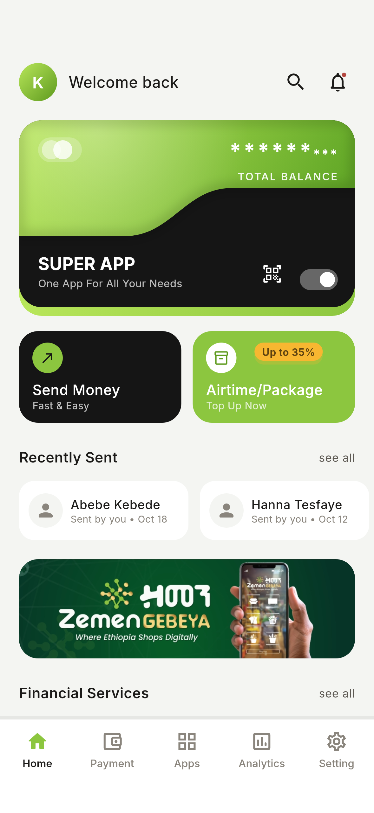
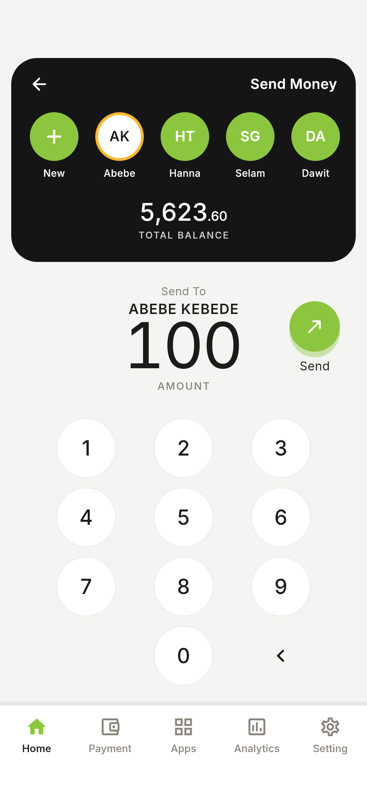
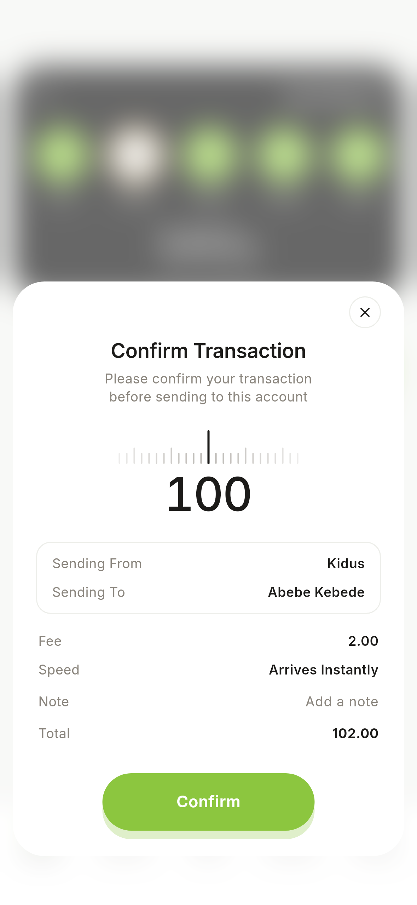
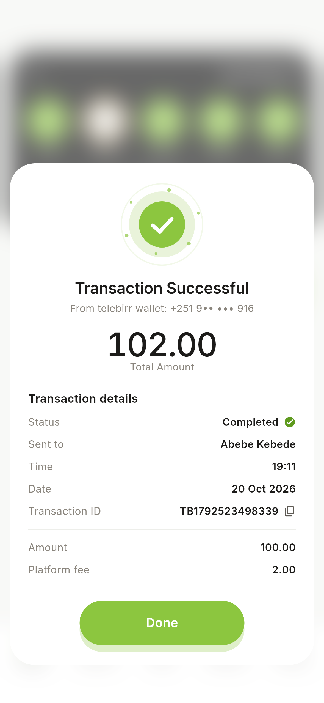
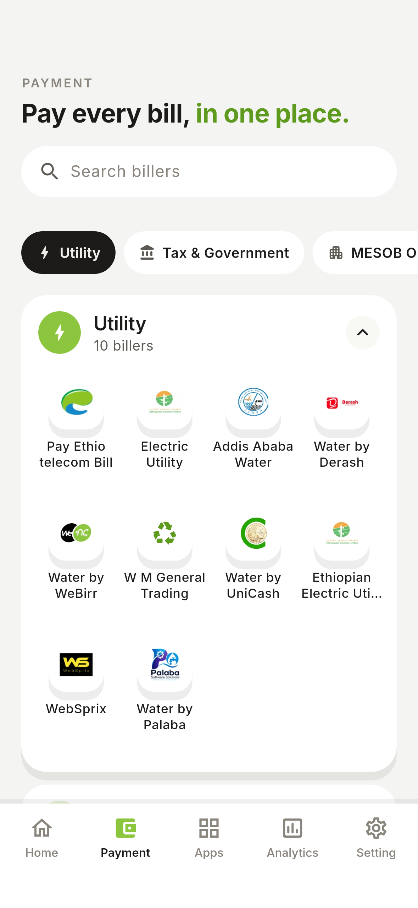
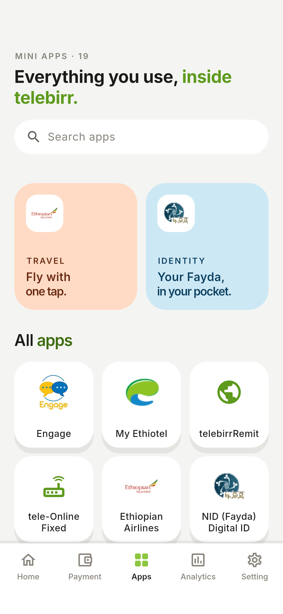
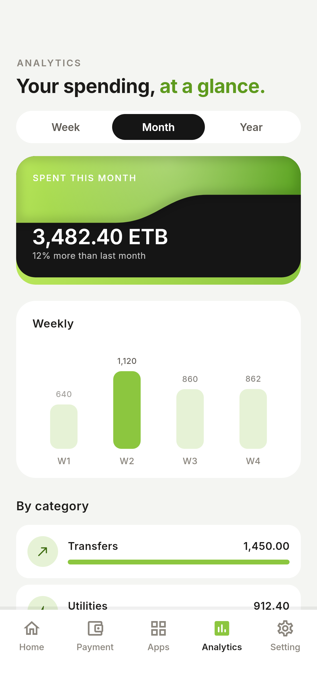
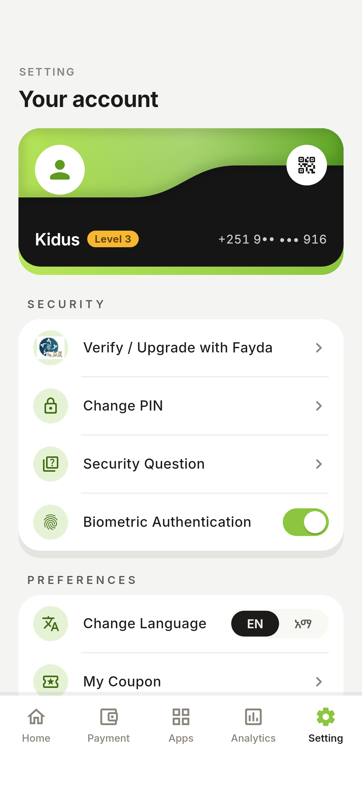

# telebirr, redesigned

A Flutter redesign of the telebirr super-app, built on the **Kidyoh Apps** design system. It keeps telebirr's own colours (leaf green, the Scan QR blue, the ribbon orange) and the real partner logos.

| Home | Send Money | Confirm | Receipt |
| --- | --- | --- | --- |
|  |  |  |  |

| Payment | Apps | Analytics | Setting |
| --- | --- | --- | --- |
|  |  |  |  |

## Run

```sh
flutter pub get
flutter run
```

There are no third-party packages. The fonts (Inter and Noto Sans Ethiopic) are bundled in `assets/fonts/`.

## What changed from the original

The Home page and the Send Money flow follow a "Telebirr SuperApp – Home Page Redesign" concept the owner supplied.

- **Home** has a near-black balance card with the telebirr green wave across the top and a second green card peeking out underneath. The balance is hidden behind stars until you flip the switch on the card, and the QR icon on the card opens the scanner. Under the card are the Send Money and Airtime/Package quick actions, Recently Sent, the Zemen Gebeya banner and Financial Services.
- **Send Money** has a dark header with your contacts and balance, a round keypad, and a green Send button. Tapping a person in Recently Sent opens it with them already picked.
- **Confirm Transaction** slides up over a blurred screen. The amount counts up over a ruler, followed by the sender, recipient, fee, speed, an optional note and the total.
- **Transaction Successful** replaces the confirm sheet in place, with a check that draws itself and the receipt details (status, time, date, a copyable transaction ID, amount and fee). Your balance updates on Home.
- **The tab bar** is Home, Payment, Apps, Analytics and Setting. Engage now lives in Apps, Account is now Setting, and Analytics is new.
- There is no italic type anywhere in the app.

## Motion

All motion uses the design system's tokens (`lib/theme/tokens.dart`):

- **Durations:** 110 / 220 / 320 / 420 / 620 ms, with a 60 ms stagger.
- **Curves:** expo, spring and back.
- **Press:** a squish of 0.96 for cards, 0.97 for pills and 0.9 for round buttons, instead of ink ripples.
- **Haptics:** a selection click on taps, a medium impact for scan and errors, and a heavy impact when money is sent.
- **Moments:** the green wave drifts and a sheen slides across it. The Send Money card grows into the Send Money header. Typed digits pop in, and the amount shakes when it's more than your balance. The Confirm button shrinks into a spinner, and the success check pops in with a pulsing halo.

## Layout

```
lib/
  theme/      tokens.dart (colour, spacing, radius, motion) · type.dart
  widgets/    WaveCard, BottomNav, Pressable, Reveal, GlassPanel, BrandTile,
              TabHeader, SectionHeader, QR sheet
  screens/    shell, home, send_money (keypad, confirm, receipt), payment,
              apps, analytics, account (Setting), engage, scan
  data/       services.dart (every service from the current app) · wallet.dart
assets/brand/ partner logos cropped from the current app
```

## Notes

- The balances, contacts, spending figures and transactions are made-up sample data, and sending only changes the balance inside the app. The scanner is a visual frame only and does not connect to a camera.
- The logos were cropped from app screenshots, so they are low-resolution. Replace them with the official vector files before shipping.
- To regenerate the screenshots, run `flutter test --update-goldens test_screenshots`.
