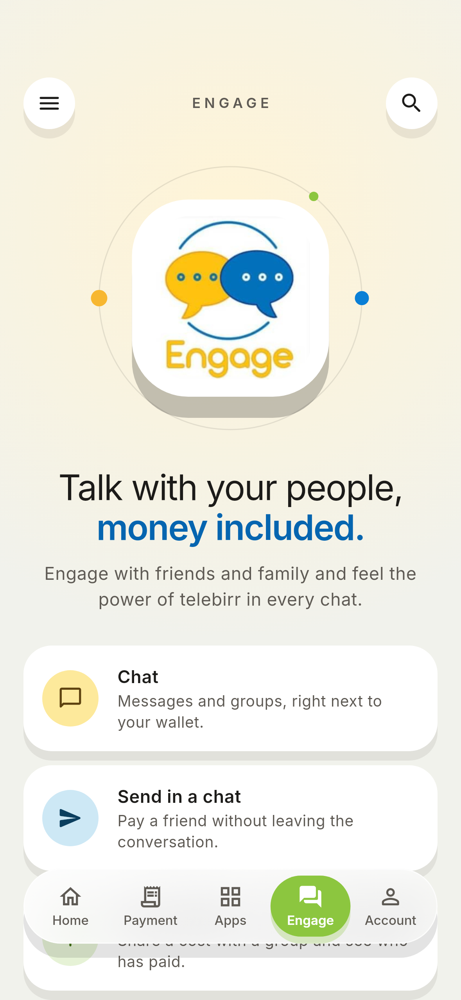
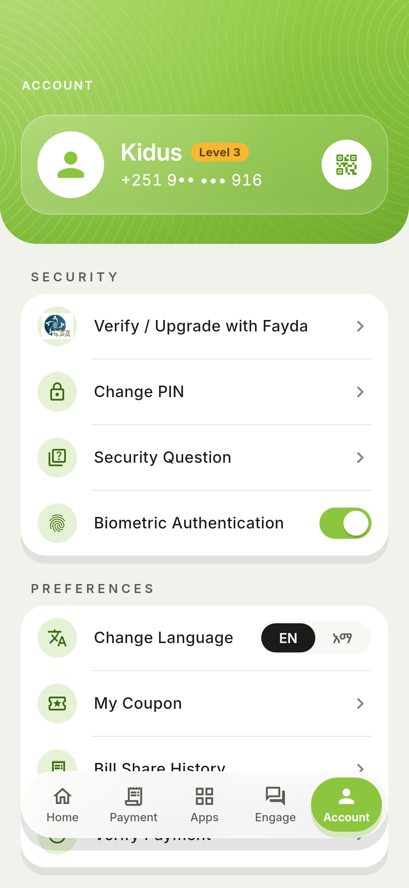
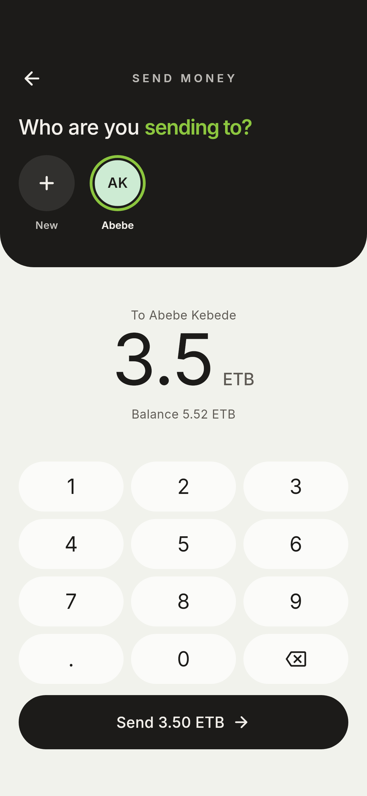
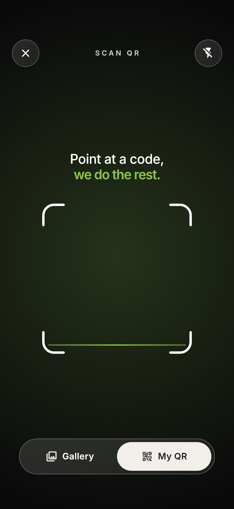

# telebirr, redesigned

A Flutter redesign of the telebirr super-app, built on the **Kidyoh Apps** design system. It keeps telebirr's own colours (leaf green, the Scan QR blue, the ribbon orange) and the real partner logos.

| Home | Payment | Apps | Engage | Account |
| --- | --- | --- | --- | --- |
|  |  |  |  |  |

| Send money | Scan QR |
| --- | --- |
|  |  |

## Run

```sh
flutter pub get
flutter run
```

There are no third-party packages. The fonts (Inter and Noto Sans Ethiopic) are bundled in `assets/fonts/`.

## What changed from the original

- **One hero per screen.** On Home, the balance is the one big number, set on the telebirr green with its concentric rings, which drift slowly. Endekise and Reward sit on frosted glass.
- **Two-beat headlines**, such as "Selam, Kidus. **one app for everything.**", with the payoff set apart by weight and colour. There is no italic type anywhere in the app.
- **Bento quick actions.** Send Money is an ink feature card. Cash In/Out and Airtime are pastel cards, and the "Up to 35%" badge pops every few seconds.
- **Floating glass nav** with a green indicator that springs between tabs. Scan QR is a glowing blue pill that only shows on Home.
- **Payment** has category chips that jump to their section, and accordions that expand with a spring. The search filters the billers as you type.
- **Apps** has featured cards and a searchable grid with a staggered entrance.
- **Account** has a profile on glass, grouped settings, an EN / አማ toggle, a biometric switch and a My QR sheet whose code draws itself in.
- **Send Money** is a new flow. The card flies in from Home as a Hero. Digits pop in as you type, the amount shakes if it's over your balance, and success fills the screen with green and draws a check mark.
- **Scan QR** has breathing corners, a sweeping scan line and glass controls.

## Motion

All motion uses the design system's tokens (`lib/theme/tokens.dart`):

- **Durations:** 110 / 220 / 320 / 420 / 620 ms, with a 60 ms stagger.
- **Curves:** expo, spring and back.
- **Press:** a squish of 0.96 for cards, 0.97 for pills and 0.9 for round buttons, instead of ink ripples.
- **Haptics:** a selection click on taps, a medium impact for scan and errors, and a heavy impact when money is sent.

## Layout

```
lib/
  theme/      tokens.dart (colour, spacing, radius, motion) · type.dart
  widgets/    Pressable, Reveal, GlassPanel, RippleBackdrop, FloatingNav,
              ScanButton, BrandTile, BalanceHero, TabHeader, Marquee, QR sheet
  screens/    shell, home, payment, apps, engage, account, send_money, scan
  data/       services.dart (every service from the current app)
assets/brand/ partner logos cropped from the current app
```

## Notes

- The balances, contacts and transactions are made-up sample data. The scanner is a visual frame only and does not connect to a camera.
- The logos were cropped from app screenshots, so they are low-resolution. Replace them with the official vector files before shipping.
- To regenerate the screenshots, run `flutter test --update-goldens test_screenshots`.
